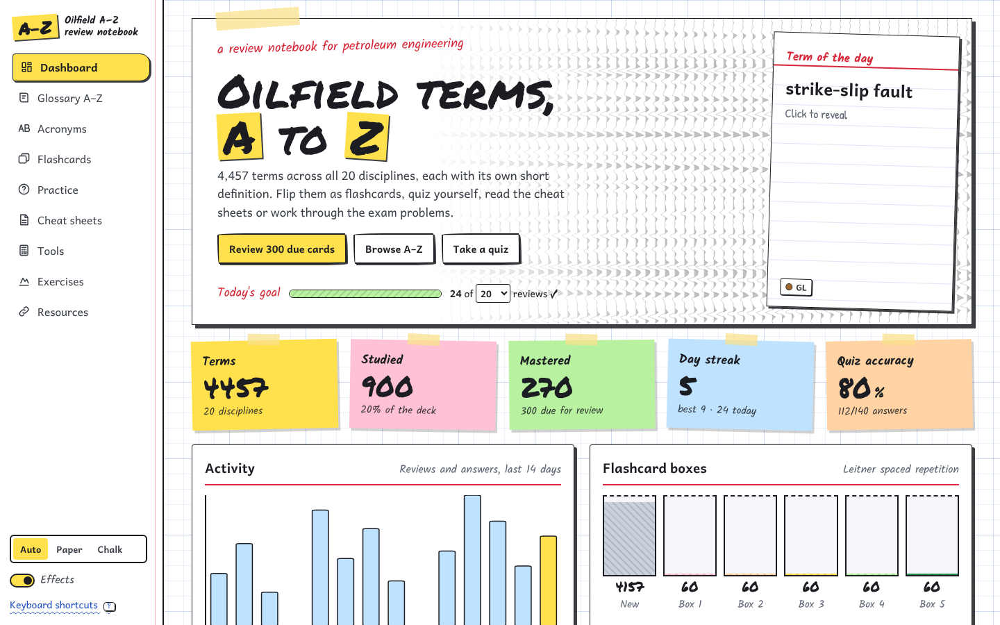

# Oilfield A–Z Reviewer 🛢️

Your petroleum engineering reviewer, except you'll actually want to open it. (Btw, I use this for reviewing concepts haha.... could be useful for petrobowl or similar competitions)

4,457 oilfield terms from A to Z, covering all 20 disciplines of the SLB Energy Glossary, plus flashcards, quizzes, cheat sheets and field calculators. Made by a PE student for PE students who'd rather *get* it than cram it the night before boards.

▶ **Start reviewing:** https://kendrewflor.github.io/oilfield-az-reviewer/



## What's inside

### 📖 Glossary A–Z
4,457 terms, one clear definition each. Filter by any of the 20 disciplines: Drilling Fluids, Geophysics, Geology, Formation Evaluation, Drilling, Well Completions, Well Workover and Intervention, Enhanced Oil Recovery, Production Testing, Well Testing, Reservoir Characterization, Production Logging, Production Facilities, Production, Shale Gas, Digital, Perforating, Oil and Gas Business, Heavy Oil and General Terms.

What you can do with it:
- Search, jump to a letter, or let **Random term** pick one for you.
- Star the terms that keep tripping you up and mark the ones you've got down.
- Leave your own notes on any term.
- Hit 🔊 to hear a term read aloud.
- Follow **see also** links to related terms.
- Turn on **Cover definitions** to quiz yourself straight from the list.
- Print whatever list you've filtered.

Every term links to its official SLB entry.

### 🃏 Flashcards
Cards flip in 3D. Swipe right if you know it, left if you don't, or use the arrow keys. Spaced repetition (Leitner boxes 1–5) brings back what you miss and spaces out what you've mastered, so you aren't reviewing the easy stuff forever.

Decks: due today, new, starred, not mastered yet, **missed in quizzes**, any discipline or any letter.

### ✍️ Practice questions
Five modes, depending on your mood:

| Mode | What it does |
|---|---|
| **Name the term** | Read a definition, pick the term. |
| **Pick the definition** | See a term, pick its meaning. |
| **Acronyms** | BOP? AVO? ECD? Pick what it stands for. |
| **Concept questions** | 100 questions, five per discipline, each one explained. |
| **Exam drill** | 20 mixed questions, 15 minutes on the clock. Board-exam energy. |

### 🔤 Acronyms and symbols
262 abbreviations and symbols in one searchable list, each linked to its term. Never blank on "SIDPP" again.

### 📝 Cheat sheets
One page per discipline: key ideas, the equations you need to memorize and a tip. Each one prints to PDF, perfect for last-minute review.

### 🧮 Tools
- **Unit converter:** psi ↔ bar, ft ↔ m, bbl ↔ m³, ppg ↔ SG and more. Ten oilfield quantities, and it shows every unit at once.
- **8 field calculators:** hydrostatic pressure, pressure gradient, kill mud weight, ECD, API gravity, volumetric OOIP, annular capacity and Archie S<sub>w</sub>.
- **Formula sheet:** every equation from the cheat sheets, searchable.

### 🧪 Exercises and projects
19 worked problems you can check yourself: kill sheets, Archie, OOIP, Vogel, Horner, decline curves, NPV with a cash-flow diagram and more. Stuck? Open the solution one step at a time. There are also 7 coursework-style mini projects with checklists.

### 📚 Resources
Free references in one place: dictionaries, papers and standards, courses, well control, data and professional societies.

### 📊 Dashboard
Track terms studied and mastered, your day streak, a daily review goal you set, quiz accuracy, a 14-day activity chart, progress per discipline and a mastery map by letter.

### ⌨️ Keyboard shortcuts
Press <kbd>?</kbd> anywhere to see them all. Quick ones: <kbd>/</kbd> to search, <kbd>R</kbd> for a random term, <kbd>Space</kbd> and the arrow keys for flashcards, <kbd>1</kbd>–<kbd>4</kbd> and <kbd>Enter</kbd> for quizzes.

## The vibe

It's built to feel like a study notebook, not another app: graph paper, index cards, handwritten definitions, typewriter equations, sticky notes and highlighter marks. Paper mode for daytime, chalkboard mode for late-night review.

Small touches keep it fun: a pencil-sketch seismic section that ripples under your cursor, an oil gusher when you get an answer right, a rubber-stamp **MASTERED**, swipe-to-grade cards and a drill-bit depth gauge as you scroll. Not your thing? Flip the **Effects** switch off. Effects also stay off if your device is set to reduce motion.

## About the definitions

The SLB Energy Glossary is copyrighted, so nothing here is copied from it. Every definition is an original summary written for studying. Each term has an **official SLB wording ↗** link to its page on [glossary.slb.com](https://glossary.slb.com/) if you want the exact text.

Every discipline has at least as many terms here as SLB lists for it. The list was compiled independently, so a few names may differ from SLB's; if a link lands on SLB's "not found" page, search for the term on their site. Discipline names follow the glossary's categories.

This is an independent student project and isn't affiliated with or endorsed by SLB.

## Your data stays yours

- Progress lives only in your browser.
- No accounts, no ads, no tracking, no cookies.
- Switching devices? Use **Export progress** in the footer, then **Import** on the other device.
- Read-aloud uses your browser's built-in speech. Some browsers use an online voice, which sends the spoken text to that browser's speech service.

## Run it locally

```sh
python3 -m http.server     # in the repo folder, then open http://localhost:8000
```

Opening `index.html` straight from your files won't load the data (browsers block that), so use a local server like the one above.

## Checks

```sh
python3 tools/security_scan.py                    # security checks
python3 tools/check_data.py
